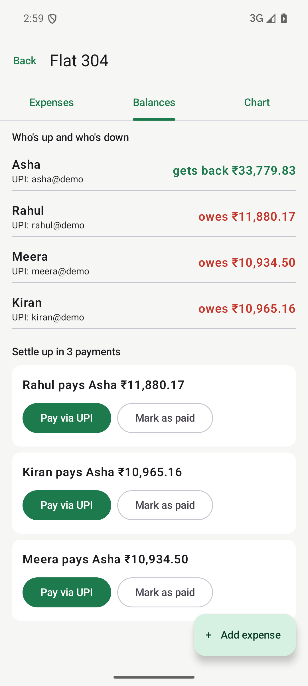

# Expense Splitter (Android app): live demo

**Try it:** https://finalcommitprojects.github.io/demo-expense-splitter/

Split bills with roommates, settle up in a few payments, and pay through any UPI app. Download the signed APK from the page.

This repository only hosts the live demo, so the JavaScript here is bundled and minified. The full source code, with the setup or training scripts, tests, documentation and the project report, comes with the project when you take it with [Final Commit](https://finalcommitprojects.github.io/?utm_source=github&utm_campaign=demo-expense-splitter).

© 2026 Final Commit. All rights reserved.
